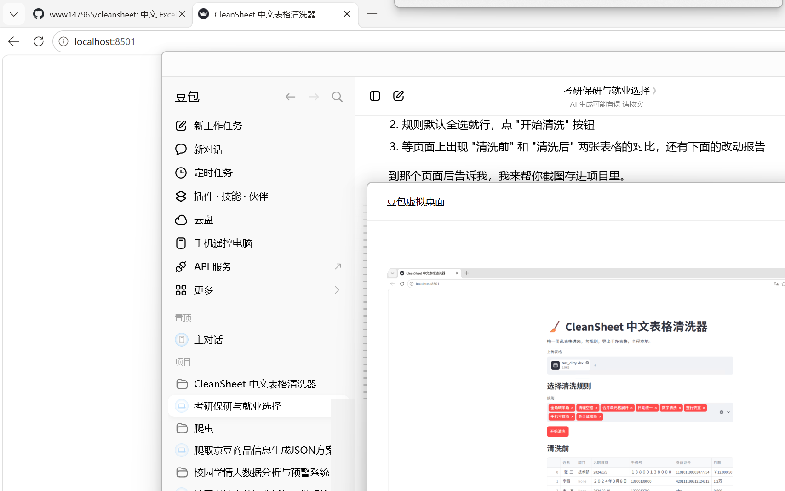
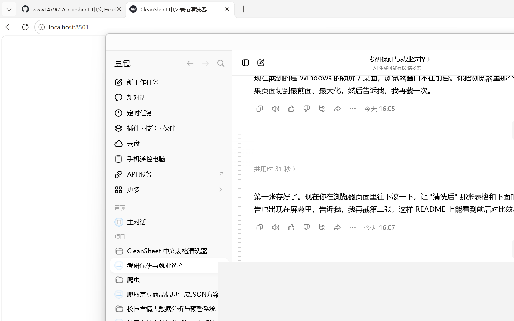

# CleanSheet 中文表格清洗器

拖进一份乱糟糟的 Excel，勾上要清洗的项，导出一份干净表格。全程本地处理，不上传任何数据。

专治中文表格里那些肉眼难发现、手动改又改到崩溃的小毛病：全角数字、合并单元格、格式混乱的日期、带人民币符号的金额、重复行，还能顺手校验手机号和身份证号格式。





## 快速开始

```bash
# 安装依赖
pip install -r requirements.txt

# 生成一份示例脏表（可选）
python examples/make_sample.py

# 命令行清洗，输出干净表格
python main.py examples/sample_dirty.xlsx -o examples/sample_cleaned.xlsx

# 或者启动网页界面（第一次用先 pip install streamlit）
streamlit run app.py
```

命令行只启用部分规则：

```bash
python main.py 输入.xlsx -o 输出.xlsx --rules spaces,dates
```

支持 `.xlsx` 和 `.csv`（csv 自动尝试 utf-8 / gbk 编码）。

网页界面跑起来后，浏览器会自动打开 `http://localhost:8501`：上传文件、勾选规则、点按钮，就能看到清洗前后的对比，最后一键下载清洗后的 xlsx。

## 内置清洗规则

| 规则参数 | 作用 |
| --- | --- |
| `fullwidth` | 全角数字字母标点转半角，如 `１２３（４）` → `123(4)` |
| `spaces` | 去首尾空格，压缩连续空格，处理中文全角空格，并删掉汉字之间误夹的空格（"张 三"→"张三"） |
| `unmerge` | 合并单元格向下填充，补上读表后丢失的内容 |
| `dates` | 把 `2024/1/5`、`2024年3月8日`、`2024.2.20` 统一成 `2024-01-05` |
| `numbers` | 去掉 `￥`、千分位逗号，支持 `1.2万`→`12000`、`8.5千`→`8500` |
| `dedup` | 按整行内容去重 |
| `phone_check` | 校验 11 位手机号格式，不合规的单元格原样保留并写进报告 |
| `id_check` | 校验 18 位身份证号（含国标校验位），不合规的写进报告 |

后两条是"只标记、不改写"的校验型规则：不会动你原来的格子，只是把格式不对的行号和原值列出来，方便人工复核。

每次清洗结束会打印一份报告：每条规则改了哪一列、改了多少处；没识别出来的日期和没通过格式校验的单元格会原样保留并列出，不会偷偷删数据。

## 目录结构

```
CleanSheet/
├── main.py              # 命令行入口
├── app.py               # Streamlit 网页界面
├── cleaner/
│   ├── pipeline.py      # 规则流水线与注册表
│   ├── rules.py         # 各条清洗规则的具体实现
│   ├── report.py        # 清洗报告
│   └── io.py            # xlsx/csv 读写，命令行和网页共用
├── examples/            # 示例脏表与生成脚本
└── tests/              # 单元测试
```

## 运行测试

```bash
python -m pytest tests/ -v
```

## 路线

- [x] 命令行核心清洗引擎
- [x] 单元测试覆盖各条规则
- [x] Streamlit 网页界面（上传、勾选、预览、下载）
- [x] 手机号 / 身份证格式校验（只标记不改写）
- [ ] 空值填充策略
