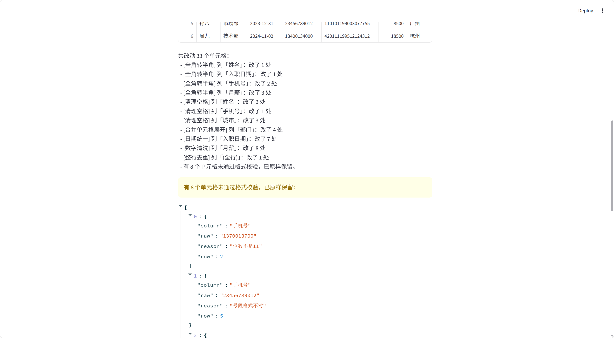

# CleanSheet 中文表格清洗器

[](https://github.com/www147965/cleansheet/actions/workflows/test.yml)

拖进一份乱糟糟的 Excel，勾上要清洗的项，导出一份干净表格。全程本地处理，不上传任何数据。

专治中文表格里那些肉眼难发现、手动改又改到崩溃的小毛病：全角数字、合并单元格、格式混乱的日期、带人民币符号的金额、重复行，还能校验手机号和身份证号格式，空值可以按需删除或填充。




## 快速开始

```bash
# 安装依赖
pip install -r requirements.txt

# 生成一份示例脏表（可选）
python examples/make_sample.py

# 命令行清洗，输出干净表格
python main.py examples/sample_dirty.xlsx -o examples/sample_cleaned.xlsx

# 或者启动网页界面（第一次用先 pip install streamlit）
streamlit run app.py
```

命令行只启用部分规则：

```bash
python main.py 输入.xlsx -o 输出.xlsx --rules spaces,dates
```

支持 `.xlsx` 和 `.csv`（csv 自动尝试 utf-8 / gbk 编码）。

网页界面跑起来后，浏览器会自动打开 `http://localhost:8501`：上传文件、勾选规则、点按钮，就能看到清洗前后的对比，最后一键下载清洗后的 xlsx。

## 内置功能

网页界面上功能分三组，用的时候一目了然。

### 格式清洗（可多选，默认全开）

| 规则 | 作用 | 举例 |
| --- | --- | --- |
| 全角转半角 | 把全角数字、字母、标点转成半角 | `１２３（４）` → `123(4)` |
| 清理空格 | 去首尾空格、压缩连续空格、处理中文全角空格，还会删掉汉字之间误夹的空格 | `张 三` → `张三` |
| 合并单元格展开 | Excel 合并过的单元格读进来下面是空的，自动向下补全 | 部门列空着的行自动补上上面的值 |
| 日期统一 | 各种写法的日期统一成横杠格式 | `2024/1/5`、`2024年3月8日`、`2024.2.20` 全变成 `2024-01-05` |
| 数字清洗 | 去掉人民币符号、千分位逗号，支持"万""千"单位换算 | `￥12,000.50` → `12000.5`，`1.2万` → `12000`，`8.5千` → `8500` |
| 整行去重 | 内容完全一样的行只保留第一条 | 重复的联系人记录自动去掉 |

### 格式校验（可多选，默认全开，只标记不改数据）

这两条不会动你原来的格子，只是把格式不对的单元格揪出来列在报告里，告诉你第几行有问题、原值是什么，方便人工复核。

| 规则 | 作用 |
| --- | --- |
| 手机号校验 | 检查是不是 11 位、1 开头、第二位是 3 到 9，位数不对或号段不对都会标出来 |
| 身份证校验 | 检查 18 位长度、前 17 位是数字、最后一位校验码对不对，用国标加权算法验证 |

### 空值处理（单选，默认保持原样）

空值怎么填是业务决定，所以做成单选，四个里选一个：

| 选项 | 作用 |
| --- | --- |
| 保持原样 | 空着就空着，不删也不填 |
| 删除全空行 | 整行什么都没填的行直接删掉 |
| 数值列用均值填充 | 数字列里的空用这一列其他数的平均值补上 |
| 文本列填"未知" | 姓名、部门这类文本列的空统一填成"未知" |

### 清洗报告

每次洗完都会出一份报告，告诉你：每条规则改了哪一列、改了多少处；哪些日期没识别出来；哪些单元格没通过校验。没识别出来的和没通过校验的都原样保留，不会偷偷删数据。

## 目录结构

```
CleanSheet/
├── main.py              # 命令行入口
├── app.py               # Streamlit 网页界面
├── cleaner/
│   ├── pipeline.py      # 规则流水线与注册表
│   ├── rules.py         # 各条清洗规则的具体实现
│   ├── report.py        # 清洗报告
│   └── io.py            # xlsx/csv 读写，命令行和网页共用
├── examples/            # 示例脏表与生成脚本
└── tests/              # 单元测试
```

## 运行测试

```bash
python -m pytest tests/ -v
```

## 路线

- [x] 命令行核心清洗引擎
- [x] 单元测试覆盖各条规则
- [x] Streamlit 网页界面（上传、勾选、预览、下载）
- [x] 手机号 / 身份证格式校验（只标记不改写）
- [x] 空值处理：删空行、数值列均值填充、文本列填未知
